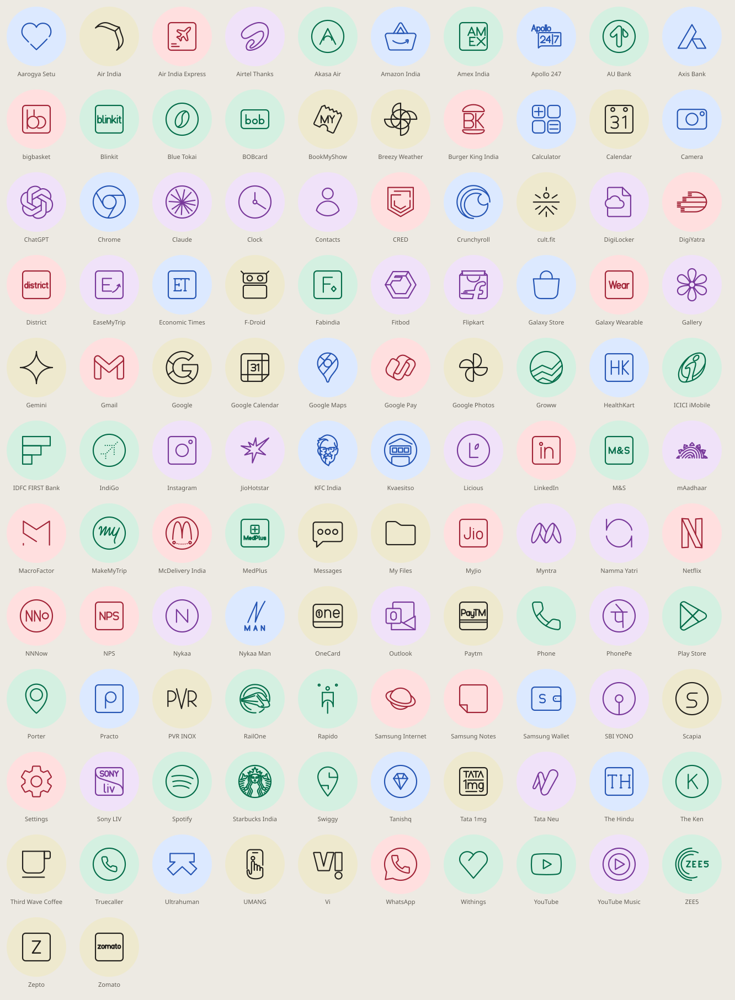

# flip7-ui

A custom UI for the Samsung Galaxy Z Flip 7: home screen, cover screen, lock screen, themes and icon packs.

Work in progress.

## Projects

| Folder | What it is |
|---|---|
| [`iconpack/`](iconpack/) | Four installable icon packs (Hinge Line, Hinge Solid, Aurelle Jewel, Aurelle Gilt) for Kvaesitso and other launchers |



## Building

Needs JDK 17+ and the Android SDK (platform 36):

```sh
./gradlew assembleRelease
```
