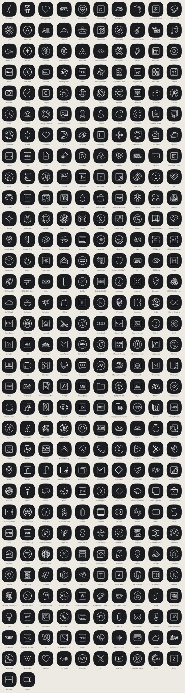

# Flip 7 icon packs

Four icon packs built from one set of line drawings, in the finishes from the UI mockups:

| Pack | Tile | Line |
|---|---|---|
| **Hinge Line** | graphite `#1A1C20` | white `#F2F2EE` |
| **Hinge Solid** | lime `#C6F432` | graphite `#0F1012` |
| **Aurelle Jewel** | gem pastels | jewel shades (emerald, ruby, sapphire, amethyst, citrine) |
| **Aurelle Gilt** | onyx `#191816` | gold `#D8AE55` |

Each is a separate app, so all four can be installed side by side and picked in the launcher. They work in Kvaesitso, Nova, Lawnchair and any launcher that supports standard icon packs. The icons are adaptive, so they follow the launcher's icon shape setting (circle suits Aurelle, squircle suits Hinge).



Previews of every pack: [Hinge Line](preview/hingeLine.svg) · [Hinge Solid](preview/hingeSolid.svg) · [Aurelle Jewel](preview/aurelleJewel.svg) · [Aurelle Gilt](preview/aurelleGilt.svg)

## What's covered

112 icons for 632 app entry points: the Indian apps on the wish list (shopping, banking, travel, food, entertainment, fitness, government, telecom, news, airlines) plus core Samsung and Google apps.

Some have no published Android component mapping yet, so they are in the pack but have to be picked by hand: **Practo, Scapia, EaseMyTrip, The Ken, Air India Express, Akasa Air, BOBcard, Licious, Blue Tokai, Burger King India, McDelivery India, Fabindia, NNNow, HealthKart, Tanishq**. The M&S icon is mapped to the UK app's package; the India app may also need picking by hand. In Kvaesitso, long-press the app → **Customize** → tap the icon → choose it from the pack. Sending the app's package name lets it be mapped automatically.

## Installing

1. Copy an APK (for example `iconpack-hingeLine-release.apk`) to the phone and open it. Allow your file manager to install unknown apps when asked; Samsung's Auto Blocker has to be off while installing.
2. In Kvaesitso: **Settings → Appearance → Icons → Icon pack** → pick the pack.

The packs don't add anything to the app drawer.

## Building

Needs JDK 17+ and the Android SDK (platform 36).

```sh
./gradlew :iconpack:assembleRelease
# APKs: iconpack/build/outputs/apk/<pack>/release/
```

Release builds are signed with the debug key so they install without a keystore; they're for personal sideloading, not for a store.

## Adding or changing icons

Everything under `src/<pack>/` and `preview/` is generated. To change the pack:

1. Edit `tools/apps.json` (an app's label, Android package, and where its drawing comes from). Custom drawings go in `icons/custom/` as 48×48 SVGs with 1-unit strokes.
2. Pull the drawings and component mappings from an [Arcticons](https://github.com/Arcticons-Team/Arcticons) checkout (it only needs `app/src/main/assets/appfilter.xml` and `icons/white/`):
   ```sh
   cd iconpack/tools
   npm install
   node import-arcticons.mjs /path/to/Arcticons
   node generate.mjs
   ```
3. Rebuild the APKs.

The tile and line colors for each finish are in `FINISHES` at the top of `tools/generate.mjs`.

## Credits and licence

- Most line drawings, and the component mappings, come from [Arcticons](https://github.com/Arcticons-Team/Arcticons) by the Arcticons team, licensed [CC BY-SA 4.0](https://creativecommons.org/licenses/by-sa/4.0/). They have been recolored, rescaled and placed on tiles. The drawings in this pack are shared under the same licence; see [icons/LICENSE.md](icons/LICENSE.md).
- The Truecaller handset and Air India Express plane in `icons/custom/` are based on [Lucide](https://lucide.dev) icons (ISC licence).
- App names and logos belong to their owners. This is a personal theming project and is not affiliated with any of them.
